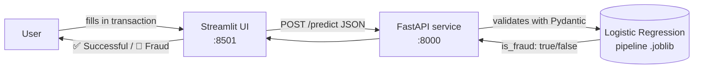
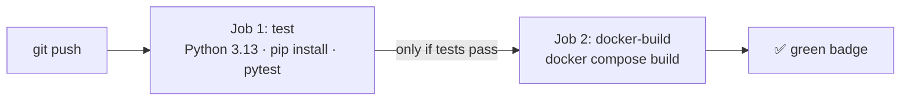

# 🛡️ VaultGuard AI

**Real-time fraud detection for financial transactions**: a machine-learning model served through a FastAPI backend, a Streamlit front end, both packaged with Docker and tested automatically with GitHub Actions on every push.


---

## 🏆 Highlights

- **End-to-end ML project**: from exploring 6.3 million raw transactions, to engineering features, to training a model, to a live prediction API and a web UI.
- **Leak-free feature engineering**: recipient-behaviour features are built only from each account's *earlier* transactions, and the model is evaluated on a **time-based split**, so the test set is strictly "the future".
- **Built for heavy class imbalance**: only 0.30% of the relevant transactions are fraud, so the model uses class weighting rather than chasing accuracy.
- **Production-style serving**: a FastAPI service with request validation (Pydantic), a `/health` endpoint and a `/predict` endpoint.
- **Containerised**: two Docker images (API and UI), slim Python 3.13 base images, non-root users, layer caching, and a container health check that the UI waits on.
- **CI pipeline with GitHub Actions**: every push runs the automated test suite, then builds both Docker images, and the build stops if a test fails.
- **Data version control**: the 1.1 GB of datasets are tracked with **DVC** and stored in an **AWS S3** remote, keeping the Git repo light.

> **In one line:** I built and containerised a fraud-detection ML service (FastAPI + Streamlit + Docker), versioned the data with DVC on S3, and set up a GitHub Actions CI pipeline that tests the API and builds the Docker images on every push.

---

## 🧭 How it works



1. The user enters a transaction in the **Streamlit** form (amount, type, hour of day, recipient history…).
2. The UI derives the model's flag features (night-time, amount band) and sends JSON to the **FastAPI** `/predict` endpoint.
3. The API validates the input against a Pydantic schema, runs the saved **scikit-learn pipeline**, and returns `{"is_fraud": true | false}`.
4. The UI shows **✅ Transaction Successful** or **🚨 Fraud Detected**.

---

## 🧰 Tech stack

| Area | Tools |
|---|---|
| Data & ML | pandas, NumPy, scikit-learn, joblib |
| Exploration | Jupyter, Matplotlib, Seaborn |
| API | FastAPI, Uvicorn, Pydantic |
| Front end | Streamlit, Requests |
| Containers | Docker, Docker Compose |
| CI | GitHub Actions, pytest, httpx |
| Data versioning | DVC with an AWS S3 remote |

---

## 📊 Dataset and key findings

VaultGuard is trained on the **PaySim** synthetic mobile-money dataset: **6,362,620 transactions** over 31 simulated days, of which **8,213 are fraudulent**.

Findings from exploratory data analysis (`Notebooks/EDA.ipynb`):

- **Fraud only happens in `TRANSFER` and `CASH_OUT` transactions.** There were none in `PAYMENT`, `DEBIT` or `CASH_IN`, so the model focuses on these two types. The UI treats every other type as legitimate without calling the model.
- Within those two types, **0.30% of transactions are fraud**, which is a severe class imbalance.
- **Amount matters a lot:** the fraud rate climbs from under 0.1% for transfers below 50K to **2.1% for transfers of 1M–10M**.
- **New recipients are riskier:** destinations with no previous transactions have the highest fraud rate (≈0.19%), and the rate falls steadily as an account's history grows.
- **Time of day matters:** fraud is proportionally more common in the night-time hours, when legitimate volume is low.
- **Data checks:** the balance columns often don't reconcile with the transaction amount, so the model doesn't use the raw balance columns.

---

## ⚙️ Feature engineering and model

**Features used by the model** (defined in `app/validation.py`):

| Feature | Meaning |
|---|---|
| `amount` | Transaction amount |
| `type` | `TRANSFER` or `CASH_OUT` |
| `dest_prev_txn_count` | Number of earlier transactions received by the recipient |
| `dest_prev_amount_sum` | Total money the recipient had received before |
| `dest_txn_count_24h` | Recipient's transactions in the last 24 hours |
| `dest_is_first_txn` | 1 if this is the recipient's first transaction |
| `is_night` | 1 if the transaction happens at night |
| `amount_1M_to_10M` | 1 if the amount is between 1M and 10M |
| `amount_is_10M` | 1 if the amount is exactly 10M (the simulator's cap) |

**Model** (`Notebooks/Modelling.ipynb`): a scikit-learn `Pipeline` with these parts:

- **Preprocessing** in a `ColumnTransformer`: `log1p` followed by `StandardScaler` for the skewed numeric columns, one-hot encoding for `type`, and binary flags passed through unchanged.
- **Classifier**: `LogisticRegression` with L1 regularisation (`C=0.001`), `class_weight="balanced"` for the imbalance, and the `liblinear` solver.
- **Validation**: a **time-based 80/20 split** on `step`. The model trains on the past and is tested on the future, which mirrors how it would be used in real life.
- The trained pipeline is saved to `models/logistic_regression_model.joblib` and loaded by the API.

---

## 📁 Project structure

```
VaultGuard/
├── .github/workflows/ci.yml     # GitHub Actions CI pipeline
├── app/                         # FastAPI service
│   ├── main.py                  #   /, /health, /predict
│   ├── validation.py            #   Pydantic input schema
│   ├── test_main.py             #   pytest tests
│   ├── requirements.txt
│   └── Dockerfile
├── UI/                          # Streamlit front end
│   ├── streamlit.py
│   ├── requirements.txt
│   └── Dockerfile
├── models/
│   └── logistic_regression_model.joblib
├── Notebooks/
│   ├── EDA.ipynb                # exploration + feature engineering
│   └── Modelling.ipynb          # training + evaluation
├── Data/                        # tracked by DVC (stored in S3)
│   ├── Transactions.csv.dvc
│   └── Modelling.csv.dvc
├── docker-compose.yml           # runs API + UI together
└── requirements.txt             # full dev environment
```

---

## 🚀 Getting started

### Option 1: Docker (recommended)

```bash
git clone https://github.com/muneebhassan437/VaultGuard-.git
cd VaultGuard-
docker compose up --build
```

- UI: <http://localhost:8501>
- API docs (Swagger): <http://localhost:8000/docs>

The UI waits until the API's health check passes before it starts.

### Option 2: Run locally

```bash
python -m venv vaultguard && source vaultguard/bin/activate
pip install -r requirements.txt

# Terminal 1: API
cd app && uvicorn main:app --reload

# Terminal 2: UI
streamlit run UI/streamlit.py
```

### Try the API directly

```bash
curl -X POST http://localhost:8000/predict \
  -H "Content-Type: application/json" \
  -d '{
        "amount": 1000,
        "dest_prev_amount_sum": 50000,
        "dest_prev_txn_count": 5,
        "dest_txn_count_24h": 2,
        "type": "TRANSFER",
        "is_night": 0,
        "dest_is_first_txn": 0,
        "amount_1M_to_10M": 0,
        "amount_is_10M": 0
      }'
# → {"is_fraud": false}
```

| Endpoint | Method | Description |
|---|---|---|
| `/` | GET | Welcome message |
| `/health` | GET | Health check: `{"status": "healthy"}` |
| `/predict` | POST | Returns `{"is_fraud": true/false}` for a transaction |

---

## ✅ Testing and CI (GitHub Actions)

The API has automated tests in `app/test_main.py`. They use FastAPI's `TestClient` to check the home page, the health check, and a full prediction from request to model to response.

```bash
cd app
pytest -v
```

**On every push to `main`**, GitHub Actions (`.github/workflows/ci.yml`) runs two jobs:



1. **test**: sets up Python 3.13, installs the API dependencies and runs pytest.
2. **docker-build**: runs only if the tests pass (`needs: test`). It builds both the API and UI Docker images to prove they still build.

If anything breaks, the run fails, GitHub sends an email, and the badge at the top of this README turns red.

---

## 🗄️ Data versioning (DVC)

The raw (~490 MB) and modelling (~630 MB) datasets are too large for Git. They're tracked with **DVC**, with the files stored in an **AWS S3** bucket and only small `.dvc` pointer files kept in Git.

```bash
dvc pull      # download the datasets (needs AWS access to the bucket)
```

---

## 🗺️ Roadmap

- [x] Exploratory data analysis and leak-free feature engineering
- [x] Logistic regression model with a time-based split
- [x] FastAPI prediction service and Streamlit UI
- [x] Docker images and Docker Compose
- [x] Data versioning with DVC and S3
- [x] **CI with GitHub Actions** (tests and Docker builds)
- [ ] CD: push images to AWS ECR and deploy to AWS ECS automatically
- [ ] Experiment tracking with MLflow and comparing against XGBoost
- [ ] Data drift monitoring with Evidently

---

## 👤 Author

**Muneeb Hassan**, [GitHub @muneebhassan437](https://github.com/muneebhassan437)

If you found this project interesting, please give it a ⭐!
